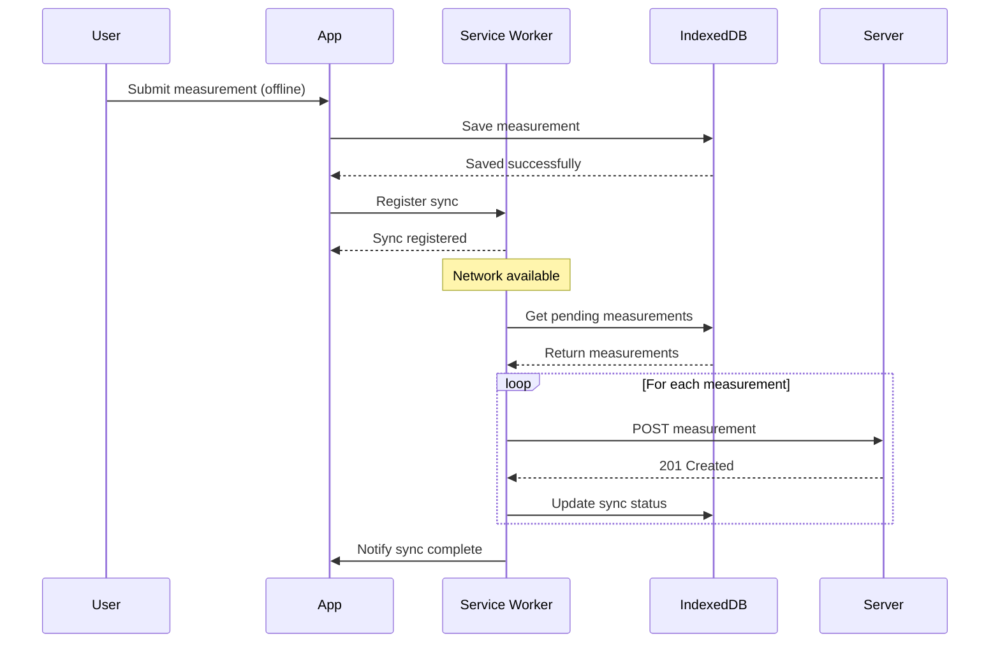

# Offline Integration Documentation

## Overview
This document describes the offline functionality implementation for the OPT Plus Digital System, enabling Barangay Health Workers (BHWs) to continue working without internet connectivity.

## Architecture

### Service Worker (`public/sw.js`)
- **Caching Strategies**: 5 different strategies for optimal performance
  - Cache First: Static assets (CSS, JS, fonts, images)
  - Network First: API calls with fallback
  - Stale-While-Revalidate: HTML pages
  - Cache Only: Offline page
  - Network Only: External resources

- **Background Sync**: Automatic synchronization when connectivity is restored
  - Tag: `sync-measurements`
  - Retries failed requests automatically
  - Syncs queued measurements from IndexedDB

### IndexedDB (`resources/js/lib/offline-db.ts`)
- **Database**: `opt-plus-offline` (version 1)
- **Object Stores**:
  1. `measurements` - Pending measurements to sync
     - Key: Auto-increment ID
     - Indexes: `childId`, `syncStatus`
  2. `children` - Cached child records
     - Key: Child ID
     - Index: `barangayId`
  3. `sync-queue` - Failed requests to retry
     - Key: Request ID
     - Index: `timestamp`

### React Hooks

#### `useOnlineStatus` (`resources/js/hooks/use-online-status.ts`)
```typescript
const isOnline = useOnlineStatus();
// Returns: boolean (true = online, false = offline)
```

#### `useServiceWorker` (`resources/js/hooks/use-service-worker.ts`)
```typescript
const { isRegistered, pendingCount, triggerSync } = useServiceWorker();
// isRegistered: boolean - SW registration status
// pendingCount: number - Count of pending sync items
// triggerSync: () => Promise<void> - Manual sync trigger
```

## Implementation Details

### Measurement Form Offline Support

**File**: `resources/js/pages/measurements/create.tsx`

**Features Implemented**:

1. **Offline Detection**
   - Detects offline state using `useOnlineStatus` hook
   - Shows amber alert when offline with sync information

2. **Offline Save**
   - Saves measurements to IndexedDB when offline
   - Data structure:
     ```typescript
     {
       childId: string;
       childName: string;
       measurementDate: string; // YYYY-MM-DD
       weightKg: number;
       heightLengthCm: number;
       muacCm?: number;
       notes?: string;
       syncStatus: 'pending';
       timestamp: number;
     }
     ```

3. **User Feedback**
   - Offline warning alert (amber) when form loads offline
   - Success alert (green) when measurement saved offline
   - Button text changes: "Save Offline" when offline
   - Auto-redirect to child profile after 2 seconds

4. **Automatic Sync**
   - Service worker detects connectivity restoration
   - Triggers background sync automatically
   - Syncs all pending measurements to server
   - Updates sync status in IndexedDB

### UI Components

#### Offline Indicator (`resources/js/components/offline-indicator.tsx`)
- Shows in app sidebar layout
- Visual states:
  - Green (online) - Hidden by default
  - Red (offline) - Shows "Offline Mode" badge
  - Yellow (syncing) - Shows sync progress
- Manual sync button when offline
- Displays pending item count

### PWA Manifest (`public/manifest.json`)
```json
{
  "name": "OPT Plus Digital",
  "short_name": "OPT+",
  "description": "Child Nutrition Tracking System",
  "start_url": "/",
  "display": "standalone",
  "theme_color": "#16a34a",
  "background_color": "#ffffff",
  "orientation": "portrait",
  "icons": [...],
  "shortcuts": [
    {
      "name": "Add Measurement",
      "url": "/measurements/create",
      "icon": "/icons/icon-192.png"
    },
    {
      "name": "View Children",
      "url": "/children",
      "icon": "/icons/icon-192.png"
    }
  ]
}
```

## User Flow

### Scenario 1: Online → Offline → Online

1. **Online**: BHW opens measurement form
2. **Goes Offline**: Amber alert appears
3. **Fills Form**: Enters weight, height, MUAC
4. **Submits**: Measurement saved to IndexedDB
5. **Success Message**: Green alert with confirmation
6. **Auto-Redirect**: Returns to child profile
7. **Goes Online**: Service worker detects connectivity
8. **Auto-Sync**: Measurements sync to server
9. **Confirmation**: Sync indicator shows success

### Scenario 2: Already Offline

1. **Offline**: BHW opens app (no internet)
2. **Cached UI**: App loads from cache
3. **Opens Form**: Amber alert shows offline mode
4. **Enters Data**: Fills measurement form
5. **Submits**: Saves to IndexedDB immediately
6. **Queue**: Measurement added to sync queue
7. **Notification**: "Saved offline - will sync"
8. **Later**: When online, auto-syncs

## Sync Process

### Background Sync Flow



### Manual Sync

Users can manually trigger sync by:
1. Clicking sync button in offline indicator
2. Button shows when offline or pending items exist
3. Triggers `triggerSync()` function
4. Shows loading state during sync
5. Updates pending count after sync

## Testing Offline Functionality

### Chrome DevTools

1. Open DevTools (F12)
2. Go to **Application** tab
3. Select **Service Workers**
4. Check "Offline" checkbox
5. Test form submission
6. Check **IndexedDB** → `opt-plus-offline` → `measurements`
7. Uncheck "Offline"
8. Watch Network tab for sync requests

### Network Throttling

1. DevTools → Network tab
2. Select "Offline" from throttling dropdown
3. Test app functionality
4. Switch to "Online" to test sync

### Manual Testing Checklist

- [ ] Form shows offline alert when offline
- [ ] Submit button changes to "Save Offline"
- [ ] Measurement saves to IndexedDB
- [ ] Success alert appears
- [ ] Offline indicator shows pending count
- [ ] Manual sync button works
- [ ] Auto-sync triggers on connectivity
- [ ] Measurements appear on server after sync
- [ ] Sync status updates in IndexedDB
- [ ] No duplicate submissions

## Error Handling

### IndexedDB Errors
```typescript
try {
    await offlineDB.addMeasurement(data);
} catch (error) {
    console.error('Failed to save offline:', error);
    alert('Failed to save measurement offline. Please try again.');
}
```

### Sync Errors
- Service worker catches sync failures
- Retries automatically on next sync event
- Keeps measurements in queue until successful
- Shows error count in offline indicator

### Network Errors
- Network First strategy with timeout (3 seconds)
- Falls back to cache if network fails
- Shows offline page if no cache available

## Performance Optimizations

### Caching Strategy
- **Static Assets**: Aggressive caching (Cache First)
- **API Calls**: Network First with cache fallback
- **HTML Pages**: Stale-While-Revalidate for fast loads
- **Cache Size**: Limit to 50 items per cache

### IndexedDB Optimization
- Indexes on frequently queried fields
- Batch operations for multiple measurements
- Automatic cleanup of synced items
- Transaction-based operations

### Service Worker Optimization
- Skip waiting for immediate activation
- Claim clients on activation
- Clean old caches on activation
- Efficient request matching

## Security Considerations

### Data Storage
- IndexedDB is origin-specific
- Data encrypted at rest by browser
- No sensitive auth tokens stored
- Auto-cleanup after sync

### Sync Authentication
- Uses existing session cookies
- CSRF tokens from cache
- Server validates all synced data
- Duplicate detection on server

## Future Enhancements

### Sprint 6 Remaining Tasks
1. **Child Data Caching**
   - Cache children list for offline browsing
   - Cache child profiles
   - Show cache freshness indicators

2. **Database Indexes**
   - Composite indexes for better query performance
   - Eager loading to prevent N+1 queries

3. **Redis Caching**
   - Cache analytics dashboard data
   - Cache report generation results
   - Implement cache invalidation

4. **Testing**
   - Unit tests for offline DB operations
   - Feature tests for sync process
   - Integration tests for offline → online flow

### Sprint 7 Ideas
1. **Advanced Offline Features**
   - Offline report viewing
   - Offline analytics dashboard
   - Photo capture and offline storage
   - GPS coordinates caching

2. **Performance**
   - Background sync for reports
   - Prefetch next likely pages
   - Image compression and caching
   - Progressive image loading

3. **User Experience**
   - Push notifications for sync status
   - Conflict resolution UI
   - Offline data size management
   - Network quality indicator

## Troubleshooting

### Common Issues

**Issue**: Service worker not registering
- **Solution**: Check HTTPS (required for SW)
- **Dev**: Use `localhost` or `127.0.0.1`
- **Check**: Browser console for errors

**Issue**: IndexedDB not saving
- **Solution**: Check browser storage quota
- **Check**: DevTools → Application → Storage
- **Fix**: Clear old data or increase quota

**Issue**: Measurements not syncing
- **Solution**: Check network connection
- **Check**: DevTools → Network tab
- **Verify**: Server endpoint accessible
- **Test**: Manual sync button

**Issue**: Duplicate measurements after sync
- **Solution**: Server-side duplicate detection
- **Check**: `measurement_date` and `child_id` uniqueness
- **Fix**: Add database constraint

### Debug Commands

```javascript
// Check service worker status
navigator.serviceWorker.getRegistration().then(reg => console.log(reg));

// List pending measurements
offlineDB.getPendingMeasurements().then(m => console.log(m));

// Trigger manual sync
navigator.serviceWorker.ready.then(reg => reg.sync.register('sync-measurements'));

// Check cache contents
caches.keys().then(keys => console.log(keys));
caches.open('opt-plus-v1').then(cache => cache.keys().then(keys => console.log(keys)));
```

## Metrics and Monitoring

### Key Metrics
- Offline usage rate
- Sync success rate
- Average sync delay
- Cache hit rate
- IndexedDB storage usage

### Logging
- Service worker sync events
- IndexedDB operations
- Network failures
- Cache hits/misses

## Conclusion

The offline functionality enables BHWs to work seamlessly in areas with poor connectivity. The implementation follows PWA best practices and provides a robust, user-friendly experience.

**Status**: Sprint 6 - 70% Complete
**Next**: Child data caching and performance optimizations
